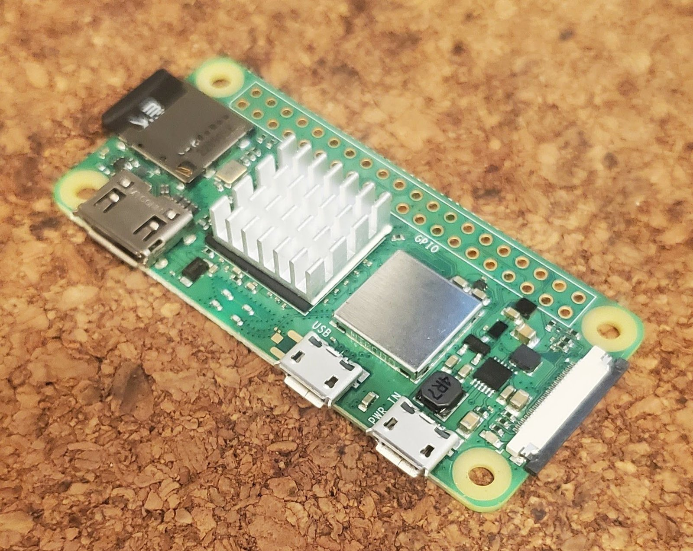

# pi-can-logger

> **Work in progress.** I'm building this logger and documenting it as I go. It doesn't log anything yet. This README, the parts list and the setup notes will be updated as parts arrive and experiments are completed.

An always-on Raspberry Pi logger for a car's OBD-II / CAN bus, built for long-term health and maintenance tracking rather than performance tuning.

- Starts and stops with the ignition, and is safe for the car's battery.
- Logs every trip at a low rate, writes a per-trip summary, and keeps the raw data only for unusual trips.
- Reads standard OBD-II PIDs plus manufacturer extended PIDs over UDS. Ford is first: it was developed on a 2017 Explorer 3.5L.
- Syncs logs over Wi-Fi when the car is parked at home.

**Status:** the Pi is set up ([docs/pi-setup.md](docs/pi-setup.md)); waiting on the first parts order ([docs/parts-list.md](docs/parts-list.md)). No logger code yet.

## Build log

### 1. Raspberry Pi Zero 2 W (2026-10-24)

The logger's computer: a Raspberry Pi Zero 2 W with a 64 GB microSD card and a stick-on aluminium heatsink. The 40-pin GPIO header isn't soldered yet; it goes on when the CAN HAT arrives. The Pi already runs a slimmed-down Raspberry Pi OS Lite with the CAN tools installed. See [docs/pi-setup.md](docs/pi-setup.md).

## Safety

The logger only reads data. It never writes to modules, runs routines or changes diagnostic sessions. Use it at your own risk: you're connecting hardware to your car's network.
